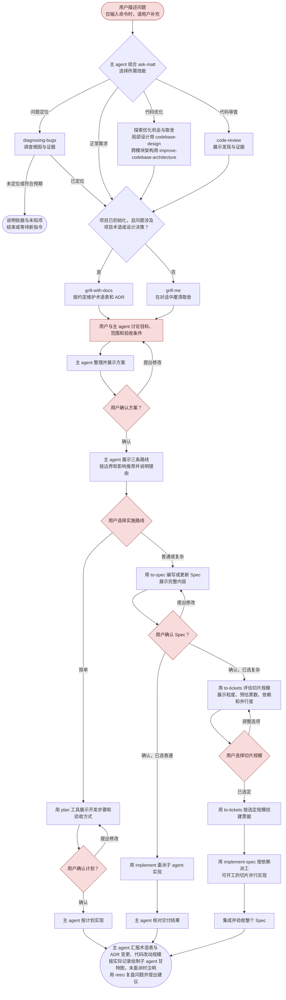

# auto-matt

**由用户决定的步骤必须在主对话中完成。** 每次展示当前待定的问题、方案或产物，请用户作答并停在该步。仅凭用户对当前事项的明确答复推进。推荐项、界面预选、沉默或子 agent 的意见均不能代替答复。用户提出修改时，更新当前内容后再请其确认。

## 入口与分流

从用户对问题的描述开始。调用时已附描述就直接使用，只有命令时请用户补充。主 agent 读取 `ask-matt`，结合问题和项目上下文选择单个技能或技能组合。按需读取所选技能的 `SKILL.md`，并把本阶段的结束条件交给执行者。

| 问题类型 | 动作及进入下一阶段的条件 |
| --- | --- |
| 问题定位 | 使用 `diagnosing-bugs`，本阶段止于定位。定位成功，带着根因和证据进入讨论。未能定位或证据表明行为符合预期，向用户说明依据和仍未知的部分，结束或等待新指令。 |
| 正常需求 | 直接进入讨论。 |
| 代码优化 | 局部接口或模块设计使用 `codebase-design`，跨模块的架构探索使用 `improve-codebase-architecture`。带着优化机会、影响和取舍进入讨论，实际改动留到实施阶段。 |
| 代码审查 | 使用 `code-review`，向用户展示发现和证据，带入讨论。审查阶段仅分析现有改动。 |

## 与用户确定方案和路线

1. **共同探索。** 查看目标项目中 `setup-matt-pocock-skills` 建立的领域文档约定（如项目指令指向的 `docs/agents/domain.md`）。项目已初始化且问题涉及项目术语或设计决策时，使用 `grill-with-docs`，按约定维护术语表和决策记录（ADR）。未初始化或问题适合在对话中定案时，使用 `grill-me`。由主 agent 就目标、范围或验收中影响结果的取舍逐项与用户讨论。
2. **确认方案。** 把讨论结果整理为具体方案，说明范围和验收条件，请用户确认。有异议就回到讨论，直到用户明确确认当前方案。
3. **选择实施路线。** 方案确认后，展示下表三条路线，结合本次改动的边界和影响推荐一条并说明理由。等用户选定路线，再准备该路线的产物。

| 路线 | 适用范围 | 由谁实施 |
| --- | --- | --- |
| 简单 | 边界集中，短计划就能说清改动和验收 | 主 agent |
| 普通 | 需要用 Spec 约定行为和验收，但可作为一个整体交付 | 主 agent 使用 `implement` 委派子 agent |
| 复杂 | 涉及多个可独立验收的切片，需要安排依赖和并行工作 | 主 agent 使用 `implement-spec` 调度子 agents |

## 按选定路线实施

- **简单** — 使用当前 agent 的 plan 工具生成开发计划，向用户展示步骤和验收方式。**等用户确认该计划**，由主 agent 实现。
- **普通** — 主 agent 使用 `to-spec` 生成 Spec，给用户查看完整内容。**等用户确认该 Spec**，主 agent 使用 `implement` 调用子 agent 实现，再核对交付结果。
- **复杂** — 主 agent 使用 `to-spec` 生成 Spec，给用户查看完整内容。**等用户确认该 Spec**，再使用 `to-tickets` 评估切片规模。此时只展示可选粒度、预估票数及对依赖和并行度的影响。**等用户选定切片规模**，才使用 `to-tickets` 实际拆分并创建票据，然后使用 `implement-spec` 并行委派已解除依赖的切片，按依赖推进直至集成并验收整个 Spec。

## 总结汇报

实施结束后，主 agent 根据本次运行的实际记录完成以下汇报。

1. 分别列出术语表和 ADR 的文件及变更要点，没有改动的项注明“无变更”。
2. 用 Mermaid 甘特图展示各子 agent 的任务、实际起止时间及重叠区间。派工和收回结果时记录时间与状态。未调用子 agent 时直接说明。时间记录缺失时标注缺项，仅绘制可核实的区间。
3. 按本次任务的差异汇报代码改动规模，给出文件数及新增、删除行数，排除任务开始前已有的无关改动。
4. 使用 `retro` 复盘本次工作流，依据具体事件指出问题并给出改进建议。

## 流程参考

红色节点由用户在主对话中参与。每次确认只对当前展示的内容生效。用户提出修改时，沿回路更新内容，再请用户确认。

